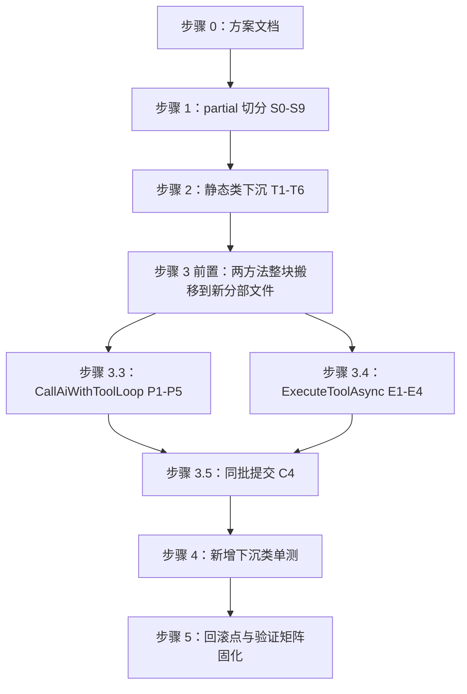

# BaseAgent.cs 拆分重构实施方案

> 基线：HEAD `8011a69`（v1.3.4）
> 目标文件：`Services/Agents/BaseAgent.cs`
> 文档性质：**规划文档，不含代码改动**。所有行号均以基线提交的原始文件为准。

---

## 1. 现状基线

| 指标 | 实测值 | 说明 |
|---|---|---|
| 文件总行数 | ≈5130 | 末尾方法在 :5052 之后 |
| 符号总数 | 141 | 含 1 个嵌套枚举、4 个事件、16 个字段 |
| partial 分部文件 | **0 个** | 当前全部成员集中单文件 |
| 类型声明 | `public abstract class BaseAgent : IDisposable`（:24） | 被 5 个子类继承 |
| 单一方法最大跨度 | `CallAiWithToolLoopAsync` **:1266 → :2519（≈1253 行）** | 占全文件约 24% |
| 第二巨方法 | `ExecuteToolAsync` **:2631 → :3162（≈531 行）** | 占全文件约 10% |
| 两巨方法合计 | ≈1785 行 / **约 35%** | 复杂度集中点 |
| 纯静态无状态方法 | ≈45 个 | 工具分类、JSON 修复、去重、路径解析 |
| 进程级锁 | `FileMutationGate` :412、`SubagentConcurrencyLimiter` :421 | 均为 `private static readonly SemaphoreSlim` |

### 1.1 文件内已有的结构边界

- `:435` `#region Abstract`（`CreateDefinition` :440、`ExecuteAsync` :448）
- `:452` `#region Shared AI Call Methods`
- `CallAiWithToolLoopAsync` 内部已有 60+ 处 `// ──` 分节注释，可直接作为阶段方法边界：
  `:1299` 循环检测状态、`:1398` Telemetry 计时、`:1402` 轮次同步缓存、`:1415` 工具定义、`:1426` 完整工具集、`:1429` 白名单构建、`:1454` MCP 注入、`:1479` 流式调用、`:1627` 主流程对账、`:1747` 处理工具调用、`:1824` 白名单拦截、`:1906` 去重、`:1945` 直探提示、`:2035` 并行执行、`:2057` 白名单拒绝、`:2093` 活跃文件追踪、`:2123` 视觉工具、`:2198` 结果裁剪、`:2244` 压缩检查、`:2247` 验证成功即结束、`:2294` 连续拒绝终止、`:2312` 移交检测、`:2331` 循环检测、`:2365` 同结果检测、`:2510` 无工具调用结束
- `ExecuteToolAsync` 内部关键分节：
  `:2638` OCR 参数预处理、`:2641` 注入 ExploreHandler、`:2828` 注入 HandoffHandler、`:2841` Git 工具审批、`:2963` 终端命令审批

### 1.2 继承与外部依赖

| 子类 | 文件 | 声明行 |
|---|---|---|
| `AskAgent` | `Services/Agents/AskAgent.cs` | :23 |
| `PlanAgent` | `Services/Agents/PlanAgent.cs` | :28 |
| `EditAgent` | `Services/Agents/EditAgent.cs` + `EditAgent.AutoSplit.cs` | :31 |
| `BuildAgent` | `Services/Agents/BuildAgent.cs` | :30 |
| `ExploreAgent` | `Services/Agents/ExploreAgent.cs` | :29 |

非继承但直接依赖 `BaseAgent` 的调用方：`Services/Agents/AgentFactory.cs`、`View/DeepSeekChatControl.Agent.cs`、`View/DeepSeekChatControl.RetryEdit.cs`、`DeepSeek_v4_for_VisualStudio.Tests` 下多个测试文件。

---

## 2. 目标结构

### 2.1 阶段 1：partial 分部切分映射

| 目标文件 | 原始行号区间 | 内容 |
|---|---|---|
| `BaseAgent.cs`（保留主文件） | 类声明、字段、构造/Dispose、`#region Abstract`、`#region Shared AI Call Methods` | 骨架 |
| `BaseAgent.ToolSet.cs` | :27–:330 | 白名单构造(:55/:77)、MCP 模式(:93–:122)、`BuildFullToolSet`(:174)、OCR 抑制(:162/:227)、工具集缓存(:236–:258) |
| `BaseAgent.Prompt.cs` | :332–:356 | `CommonSystemPromptPrefixCore`、`GetCommonSystemPromptPrefix`、`GetSharedImmutablePrefix`(:353) |
| `BaseAgent.HandoffCache.cs` | :553–:766 | `CaptureLastSentMessagesForCache`(:553)、`SyncSentMessagesToHistory`(:577)、`SnapshotHandoffCacheMessages`(:603/:620)、`PrepareHandoffCacheMessages`(:692)、`TryCompressToolLoopContext`(:704)、`CloneApiMessages`(:766) |
| `BaseAgent.Messages.cs` | :789–:1124 | `BuildContextAwareMessages` ×3(:789/:796/:1071)、`ApplyCurrentUserQuestionPrefix`(:974/:984)、`CreateCurrentUserMessage`(:1042)、`ApplyPendingGuidanceMessageAsync`(:1090) |
| `BaseAgent.Handoff.cs` | :3204–:3389 | `ConvertHandoffRequestToHandoff`(:3204)、`BuildLightweightPlanFromHandoff`(:3238)、`ExecuteHandoffAsync`(:3277) |
| `BaseAgent.Explore.cs` | :3650–:3737 | `RegisterExploreAgent`(:3650) 及 4 个事件转发(:3669/:3681/:3699/:3717/:3730) |
| `BaseAgent.Interaction.cs` | :3919–:4102、:4654–:4914 | 遥测包装(:3920/:3947)、权限与提问 8 个公开方法(:4654/:4698/:4743/:4753/:4768/:4835/:4845/:4862) |
| `BaseAgent.Diagnostics.cs` | :4915–:4988 | `NotifyFileChange`(:4915)、`RaiseLogEntryAdded`(:4937)、`AddLog`(:4946)、`SummarizeForLog`(:4966) |

### 2.2 阶段 2：下沉为 internal static 类

| 新类 | 来源行号 | 方法 |
|---|---|---|
| `ToolClassifier` | :3738–:3919 | `IsFileModifyingTool`、`IsFileAccessingTool`、`GetToolOperationName`、`ExtractAnyPathFromToolArgs`、`IsInteractiveTool`、`NormalizeToolName`、`GetToolTimeout`、`IsWriteTool`、`IsDirectExplorationTool` |
| `VerificationLoopDecider` | :1125–:1265 | `ClassifyVerificationRound`(:1139)、`DecideVerificationLoopTermination`(:1182)、`FindVerificationResultIndex`(:1219) |
| `ToolCallDeduplicator` | :4137 / :4172 / :4197 | `DeduplicateToolCalls`、`NormalizeToolArguments`、`ExtractFilePathFromToolArgs` |
| `AgentJsonHelper` | :4384 / :4416 / :4530 / :4552 / :4565 | `ExtractJsonFromMarkdown`、`TryRepairTruncatedJson`、`IsJsonBracketBalanced`、`CountLines`、`CountDiffLines` |
| `AgentPathResolver` | :3163 / :3180 / :3192 / :4029 / :4596 / :5001 | `ProjectFileExtensions`、`IsProjectFile`、`GetWorkspaceRoot`、`ResolveToAbsolutePath`、`ResolveFilePath`、`NormalizePath` |
| `ExecutionLimits`（可选） | :4245 / :4257 / :4269 | `ResolveEffectiveToolRoundLimit`、`ResolveSubagentWatchdogTimeout`、`NormalizeExecutionSetting` |

### 2.2.1 下沉类完整签名表

> 说明：下表签名以「能反映当前用途的最小骨架」给出，**实际迁移必须以原方法现有签名为准**，逐个对照原定义复制参数列表与返回类型；表中 `AgentContext`、`ChatApiMessage`、`ToolCall`、`ToolDefinition` 等类型沿用项目现有 `Models` 命名空间下的定义。

#### `ToolClassifier`（来源 :3738–:3919）

| 方法签名 | 原可见性 | 迁移后 | 说明 |
|---|---|---|---|
| `internal static bool IsFileModifyingTool(string toolName)` | `private static` | `internal static` | 判定工具是否修改文件 |
| `internal static bool IsFileAccessingTool(string toolName)` | `private static` | `internal static` | 判定工具是否读取文件 |
| `internal static string GetToolOperationName(string toolName)` | `private static` | `internal static` | 取工具操作名用于 UI 展示 |
| `internal static string? ExtractAnyPathFromToolArgs(string toolName, string arguments)` | `private static` | `internal static` | 从工具参数 JSON 中提取任意路径 |
| `internal static bool IsInteractiveTool(string toolName)` | `private static` | `internal static` | 判定是否为需审批的交互型工具 |
| `internal static string NormalizeToolName(string? toolName)` | `internal static` | `internal static` | 工具名规范化，**测试直连** |
| `internal static TimeSpan GetToolTimeout(string toolName)` | `private static` | `internal static` | 按工具类型取超时 |
| `internal static bool IsWriteTool(string toolName)` | `private static` | `internal static` | 判定写工具 |
| `internal static bool IsDirectExplorationTool(string toolName)` | `internal static` | `internal static` | 判定直探工具 |

另含 `ShouldSuppressOcrTools`（原 :162）与 `ShouldBlockOcrToolExecution`（原 :227）两个 OCR 判定方法，均为 `internal static`，测试直连。

#### `VerificationLoopDecider`（来源 :1125–:1265）

| 成员 | 原可见性 | 迁移后 | 说明 |
|---|---|---|---|
| `[Flags] internal enum VerificationRoundStatus { ... }` | 嵌套枚举 :1125 | **保留在 `BaseAgent`** | 保留 `[Flags]` 与成员顺序；不迁出以避免测试 12 处限定引用改动 |
| `internal static VerificationRoundStatus ClassifyVerificationRound(...)` | `internal static` :1139 | `internal static` | 验证轮次分类，**测试直连** |
| `internal static bool DecideVerificationLoopTermination(VerificationRoundStatus status, ...)` | `internal static` :1182 | `internal static` | 循环终止判定，**测试直连** |
| `internal static int FindVerificationResultIndex(...)` | `private static` :1219 | `internal static` | 定位验证结果消息下标 |

#### `ToolCallDeduplicator`（来源 :4137 / :4172 / :4197）

| 方法签名 | 原可见性 | 迁移后 | 说明 |
|---|---|---|---|
| `internal static List<ToolCall> DeduplicateToolCalls(IReadOnlyList<ToolCall> calls)` | `private static` | `internal static` | 按「同函数名 + 同参数」去重 |
| `internal static string NormalizeToolArguments(string? arguments)` | `private static` | `internal static` | 参数 JSON 归一化 |
| `internal static string? ExtractFilePathFromToolArgs(string toolName, string arguments)` | `private static` | `internal static` | 从参数中提取文件路径 |

#### `AgentJsonHelper`（来源 :4384 / :4416 / :4530 / :4552 / :4565）

| 方法签名 | 原可见性 | 迁移后 | 说明 |
|---|---|---|---|
| `internal static string? ExtractJsonFromMarkdown(string text)` | `protected static` :4384 | `internal static` | 从 Markdown 围栏提取 JSON；`PlanAgent:559/594` 使用 |
| `internal static string TryRepairTruncatedJson(string json)` | `protected static` :4416 | `internal static` | 截断 JSON 修复；`PlanAgent:624` 使用 |
| `internal static bool IsJsonBracketBalanced(string text)` | `private static` :4530 | `internal static` | 括号配平判定 |
| `internal static int CountLines(string? text)` | `protected static` :4552 | `internal static` | 行数统计；`EditAgent:788/792/1636` 使用 |
| `internal static int CountDiffLines(string? before, string? after)` | `protected static` :4565 | `internal static` | 差异行统计；`EditAgent:780` 使用 |

#### `AgentPathResolver`（来源 :3163 / :3180 / :3192 / :4029 / :4596 / :5001）

| 成员签名 | 原可见性 | 迁移后 | 说明 |
|---|---|---|---|
| `internal static IReadOnlyCollection<string> ProjectFileExtensions { get; }` | `protected static` 字段 :3163 | `internal static` 属性 | 改为只读属性，避免外部改写 |
| `internal static bool IsProjectFile(string path)` | `protected static` :3180 | `internal static` | 判定项目文件 |
| `internal static string GetWorkspaceRoot(AgentContext context)` | `protected static` :3192 | `internal static` | **高风险**，见 3.5 节的 `new` 隐藏约束 |
| `internal static string? ResolveToAbsolutePath(string path, string workspaceRoot)` | `private static` :4029 | `internal static` | 相对转绝对路径 |
| `internal static string? ResolveFilePath(string? path, AgentContext? context)` | `protected static` :4596 | `internal static` | 路径解析主入口 |
| `internal static string NormalizePath(string? path)` | `protected static` :5001 | `internal static` | 路径规范化；`EditAgent:809/2401` 使用 |

#### `ExecutionLimits`（可选，建议纳入；来源 :4245 / :4257 / :4269）

| 方法签名 | 原可见性 | 迁移后 | 说明 |
|---|---|---|---|
| `internal static int ResolveEffectiveToolRoundLimit(...)` | `internal static` | `internal static` | 有效轮数上限，**测试直连** |
| `internal static TimeSpan ResolveSubagentWatchdogTimeout(int configuredSeconds)` | `internal static` | `internal static` | 子代理看门狗超时 |
| `internal static int NormalizeExecutionSetting(...)` | `internal static` | `internal static` | 执行设置归一化 |

### 2.3 阶段 3：巨方法分解落点

- `BaseAgent.ToolLoop.cs`：`CallAiWithToolLoopAsync` 本体 + P1~P5 阶段方法 + `ToolLoopState` 私有状态容器
- `BaseAgent.ToolDispatch.cs`：`ExecuteToolAsync` 本体 + E1~E4 阶段方法 + `ToolInvocationContext` 私有上下文

---

## 3. 不可破坏项（硬约束）

### 3.1 protected API 契约

约 25 个成员为 `protected` / `protected static`，被 5 个子类继承使用。**下沉实现后，`BaseAgent` 上必须保留一行转发，不得删除 API**。

> 重要澄清：阶段 1 搬到分部文件的成员（`CreateReadOnlyTextPhaseToolWhitelist`、`BuildFullToolSet`、`GetFullToolSet`、`InvalidateFullToolSetCache`、`BuildContextAwareMessages`、`ExecuteHandoffAsync`、`AddLog`、`NotifyFileChange` 等）**仍属于 `BaseAgent` 类型**，无需转发。真正需要转发的只有被搬到独立 `internal static` 类里的成员。

### 3.2 保留转发表

| BaseAgent 保留成员（原行号） | 可见性 | 转发实现 | 依赖方 |
|---|---|---|---|
| `ProjectFileExtensions` :3163 | `protected static` | `=> AgentPathResolver.ProjectFileExtensions` | 内部 |
| `IsProjectFile` :3180 | `protected static` | `=> AgentPathResolver.IsProjectFile(path)` | 内部 |
| `GetWorkspaceRoot` :3192 | `protected static` | `=> AgentPathResolver.GetWorkspaceRoot(context)` | `AskAgent:151/231`、`BuildAgent:127` |
| `NormalizePath` :5001 | `protected static` | `=> AgentPathResolver.NormalizePath(path)` | `EditAgent:809/2401` |
| `ResolveFilePath` :4596 | `protected static` | `=> AgentPathResolver.ResolveFilePath(path, context)` | 内部 |
| `CountLines` :4552 | `protected static` | `=> AgentJsonHelper.CountLines(text)` | `EditAgent:788/792/1636` |
| `CountDiffLines` :4565 | `protected static` | `=> AgentJsonHelper.CountDiffLines(before, after)` | `EditAgent:780` |
| `ExtractJsonFromMarkdown` :4384 | `protected static` | `=> AgentJsonHelper.ExtractJsonFromMarkdown(text)` | `PlanAgent:559/594` |
| `TryRepairTruncatedJson` :4416 | `protected static` | `=> AgentJsonHelper.TryRepairTruncatedJson(json)` | `PlanAgent:624` |
| `IsJsonBracketBalanced` :4530 | `private static` | `=> AgentJsonHelper.IsJsonBracketBalanced(text)` | 内部 |
| `ShouldSuppressOcrTools` :162 | `internal static` | `=> ToolClassifier.ShouldSuppressOcrTools(...)` | 测试直连 |
| `ShouldBlockOcrToolExecution` :227 | `internal static` | `=> ToolClassifier.ShouldBlockOcrToolExecution(...)` | 测试直连 |
| `ClassifyVerificationRound` :1139 | `internal static` | `=> VerificationLoopDecider.ClassifyVerificationRound(...)` | 测试直连 |
| `DecideVerificationLoopTermination` :1182 | `internal static` | `=> VerificationLoopDecider.DecideVerificationLoopTermination(...)` | 测试直连 |
| `FindVerificationResultIndex` :1219 | `internal static` | `=> VerificationLoopDecider.FindVerificationResultIndex(...)` | 内部 |
| `NormalizeToolName` | `internal static` | `=> ToolClassifier.NormalizeToolName(toolName)` | 测试直连 |
| `ResolveEffectiveToolRoundLimit` :4245 | `internal static` | `=> ExecutionLimits.ResolveEffectiveToolRoundLimit(...)` | 测试直连 |
| `DeduplicateToolCalls` :4137 | `private static` | `=> ToolCallDeduplicator.DeduplicateToolCalls(calls)` | 内部 |
| `NormalizeToolArguments` :4172 | `private static` | `=> ToolCallDeduplicator.NormalizeToolArguments(arguments)` | 内部 |
| `ExtractFilePathFromToolArgs` :4197 | `private static` | `=> ToolCallDeduplicator.ExtractFilePathFromToolArgs(...)` | 内部 |

**`VerificationRoundStatus` 枚举处理决策**：枚举**保留在 `BaseAgent` 上**（不随 `VerificationLoopDecider` 迁走），避免 `BaseAgentVerificationTests.cs` 中 12 处 `BaseAgent.VerificationRoundStatus.X` 限定式引用被迫改动，也避免嵌套类型语义变化。

### 3.3 测试影响面清单

| 测试文件 | 直连成员 | 影响判定 |
|---|---|---|
| `BaseAgentTests.cs` | `NormalizeToolName`、`ShouldSuppressOcrTools`、`ShouldBlockOcrToolExecution`、`ApplyCurrentUserQuestionPrefix`、`ResolveEffectiveToolRoundLimit`、`ResolveSubagentWatchdogTimeout`、`BuildReasoningLoopRetryPrompt`、`NormalizeExecutionSetting`，以及 8 处 `typeof(BaseAgent).GetMethod` 反射 | 经转发表**零改动**；反射目标仍在 `BaseAgent` 上 |
| `BaseAgentWhitelistRecoveryTests.cs` | `AskDirectExplorationHintThreshold`（:27，`internal const`） | 常量留在 `BaseAgent`，**零改动** |
| `BaseAgentVerificationTests.cs` | `ClassifyVerificationRound`、`DecideVerificationLoopTermination`、`VerificationRoundStatus` | 枚举不迁 + 转发保留，**零改动** |
| `BaseAgentToolChainTests.cs` | `CleanIncompleteToolChains` | 未下沉，**零改动** |
| `BaseAgentHandoffEditStepsTests.cs` | `BuildLightweightPlanFromHandoff`、`ExecuteHandoffAsync` | 仅换文件，**零改动** |
| `AskAgentTests.cs` / `EditAgentTests.cs` / `PlanAgentTests.cs` | `Definition`、`Context`、`PendingHandoffRequest` 等实例成员 | 不受影响 |

新增测试（用户已选择「改为 internal 并补新增测试」）：为 5 个下沉类各建一个测试文件，直接对 `internal static` 方法做细粒度覆盖。

### 3.4 并发与状态约束

- `FileMutationGate`（:412）、`SubagentConcurrencyLimiter`（:421）**必须保持 `private static readonly SemaphoreSlim`**，持有对象与锁范围不变。
- `_logs`、`Context`、`PendingHandoffRequest`、`_pendingPermissions`、`_pendingQuestions`、工具集缓存、`ContextManager` 的**字段归属不变**，不得搬入状态容器。
- 阶段 3 的状态容器仅承载原局部变量，生命周期严格限于单次调用栈内，禁止 `static` 字段或实例字段缓存。

### 3.5 跨层公开契约

- `ExecuteHandoffAsync`（:3277）、`SnapshotHandoffCacheMessages`（:603/:620）被 `View` 层直接调用，签名、参数顺序、可见性一律不得变。
- `InvalidateFullToolSetCache`（:253）、`WireExploreLogs`（:3681）被 `AgentFactory` 调用，保持 `public`。
- `BuildAgent.cs:298` 的 `private static new string GetWorkspaceRoot(AgentContext context)` 通过 `new` 隐藏基类同名方法，基类签名必须逐字保留，否则触发 **CS0109** 且 `BuildAgent:127` 语义静默漂移。

---

## 4. 分步迁移清单

### 4.1 执行顺序原则

切割点之后的代码整体位移不影响上方原始行号，因此阶段 1 采用 **自尾向上**（`:4915` → `:27`）顺序执行。每一步只切一个逻辑单元，切完立即编译；任一步失败仅回退该步，不影响已完成步骤。

**行号漂移处理**：本文所有行号均为基线 `8011a69` 的原始行号，仅用于首次定位。实际执行时必须用符号名定位（`symbol_search` 或 `get_file_symbols`），不得硬编码行号——前序步骤的搬移会使后续行号整体位移。

**namespace 书写形式**：分部文件必须与主文件 `BaseAgent.cs` 的 namespace 与 using 风格完全一致（若主文件为块式 namespace 则沿用块式，若为 file-scoped 则沿用 file-scoped），不引入风格混用。

### 4.1.1 分部文件统一头部模板

每个新建分部文件使用同一骨架，仅 XML 文档注释的描述不同：

```csharp
using System;
using System.Collections.Generic;
using System.Linq;
using System.Threading;
using System.Threading.Tasks;
using DeepSeek_v4_for_VisualStudio.Models;
using DeepSeek_v4_for_VisualStudio.Services.Interfaces;

namespace DeepSeek_v4_for_VisualStudio.Services.Agents;

/// <summary>
/// <see cref="BaseAgent"/> 的 XXX 分部实现。
/// 承载 XXX 相关成员，以便主文件聚焦 Agent 执行编排。
/// </summary>
public abstract partial class BaseAgent
{
    // ── 此处放置从主文件整块搬运的成员，内容与顺序保持原样 ──
}
```

**模板硬规则**：

1. 分部文件**不重复书写基类与接口列表**（`: IDisposable` 只在主文件出现），避免 CS0263。
2. 主文件类声明改为 `public abstract partial class BaseAgent : IDisposable`。
3. `using` 按编译错误逐个补齐，禁止为省事写文件级 `using` 别名或 `global using`。
4. 搬运块内**不得**任何 token 级改写：不改方法体、不改注释、不改成员顺序。唯一允许的差异是缩进与 `using` 头部。

### 4.2 阶段 1 步骤明细

| 序 | 目标文件 | 原始行号 | 搬移规模 | 验证点 |
|---|---|---|---|---|
| 1.0 | 主文件加 `partial` | :24 类声明 | 1 行 | `build_solution` |
| 1.1 | `BaseAgent.Diagnostics.cs` | :4915–:4988 | ≈74 行 | `build_solution`（`AddLog` 子类调用） |
| 1.2 | `BaseAgent.Interaction.cs` | :4654–:4914 | ≈261 行 | `build_solution`（View 层 public 调用） |
| 1.3 | `BaseAgent.Interaction.cs`（追加） | :3919–:4102 | ≈184 行 | `build_solution`（无 CS0111） |
| 1.4 | `BaseAgent.Explore.cs` | :3650–:3737 | ≈88 行 | `build_solution`（`ref` 参数调用） |
| 1.5 | `BaseAgent.Handoff.cs` | :3204–:3389 | ≈186 行 | `build_solution` + `BaseAgentHandoffEditStepsTests` |
| 1.6 | `BaseAgent.Messages.cs` | :789–:1124 | ≈336 行 | `build_solution`（3 重载全在） |
| 1.7 | `BaseAgent.HandoffCache.cs` | :553–:766 | ≈214 行 | `build_solution` + `AskAgentTests` |
| 1.8 | `BaseAgent.Prompt.cs` | :332–:356 | ≈25 行 | `build_solution` |
| 1.9 | `BaseAgent.ToolSet.cs` | :27–:330 | ≈304 行 | `build_solution` + `BaseAgentWhitelistRecoveryTests` |

#### 阶段 1 逐步迁移清单（详细）

每个 S 步统一执行四件事：① 新建分部文件并写入模板骨架；② 从主文件整块剪切目标区间粘贴进去；③ 主文件删除该区间；④ `build_solution`。

**S0 · 主文件加 `partial`**

- 动作：`BaseAgent.cs:24` 的 `public abstract class BaseAgent : IDisposable` → `public abstract partial class BaseAgent : IDisposable`
- 规模：1 行
- 验证：`build_solution` 成功（加 `partial` 而未拆分不改变任何语义）

**S1 · `BaseAgent.Diagnostics.cs`（原 :4915–:4988，≈74 行）**

- 搬运符号：`NotifyFileChange`(:4915)、`RaiseLogEntryAdded`(:4937)、`AddLog`(:4946)、`SummarizeForLog`(:4966)
- 选此为首步的原因：诊断群依赖最少、无跨成员调用，用作校准搬运流程的热身
- 验证：`build_solution`；重点确认 `AddLog`（4 个文件 45+ 调用）与 `SummarizeForLog`（4 个子类）无 CS0122/CS0117
- 回滚：删除该分部文件 + 成员搬回原位

**S2 · `BaseAgent.Interaction.cs` 第二段（原 :4654–:4914，≈261 行）**

- 搬运符号：权限与提问 8 个公开方法（:4654、:4698、:4743、:4753、:4768、:4835、:4845、:4862）
- 命令清单：`RequestPermissionAsync`、`RequestTerminalApprovalAsync`、`TryGetPendingPermission`、`RespondToPermission`、`RequestAskQuestionsAsync`、`TryGetPendingQuestion`、`RespondToQuestions`、`RequestFileDeleteConfirmationAsync`
- 验证：`build_solution`；确认 `View/DeepSeekChatControl*.cs` 对这些 public 成员的调用无错
- 回滚：删除分部文件（此时该文件只含本段）

**S3 · `BaseAgent.Interaction.cs` 第一段（原 :3919–:4102，≈184 行，追加到 S2 的同一文件）**

- 搬运符号：遥测包装 `ExecuteToolWithTelemetryAsync`(:3920)、`ExecuteToolWithTelemetryCoreAsync`(:3947)，以及区间内其余交互/事件成员
- 验证：`build_solution`；确认无 CS0111（同一分部文件中出现重复成员定义）
- 回滚：只回退本段（S2 内容保留）

**S4 · `BaseAgent.Explore.cs`（原 :3650–:3737，≈88 行）**

- 搬运符号：`RegisterExploreAgent`(:3650，带 `ref` 参数)、`OnExploreLog`(:3669)、`WireExploreLogs`(:3681)、`OnExplorePermissionRequested`(:3699)、`OnExploreQuestionsRequested`(:3717)、`OnExploreFileChange`(:3730)
- 验证：`build_solution`；重点核对 `EditAgent.cs:82`、`PlanAgent.cs:60/68` 的 `ref` 调用与 `AgentFactory.cs:185/212/217` 的 `WireExploreLogs` 调用
- 回滚：删除分部文件

**S5 · `BaseAgent.Handoff.cs`（原 :3204–:3389，≈186 行）**

- 搬运符号：`ConvertHandoffRequestToHandoff`(:3204)、`BuildLightweightPlanFromHandoff`(:3238)、`ExecuteHandoffAsync`(:3277)
- 硬约束：`ExecuteHandoffAsync` 被 `View/DeepSeekChatControl.Agent.cs:1133`、`View/DeepSeekChatControl.RetryEdit.cs:370/434` 直接调用，签名/参数顺序/可见性逐字不变；`BuildLightweightPlanFromHandoff` 保持 `internal static`
- 验证：`build_solution` + `run_tests`，过滤器 `FullyQualifiedName~BaseAgentHandoffEditStepsTests`
- 回滚：删除分部文件

**S6 · `BaseAgent.Messages.cs`（原 :789–:1124，≈336 行）**

- 搬运符号：`BuildContextAwareMessages` 三重载(:789、:796、:1071)、`ApplyCurrentUserQuestionPrefix`(:974、:984)、`CreateCurrentUserMessage`(:1042)、`ApplyPendingGuidanceMessageAsync`(:1090)
- 硬约束：**三个重载必须整组搬迁**（:789 与 :1071 均转发到 :796），不得只搬其一；切割终点必须停在 :1124，不得切入 :1125 的 `VerificationRoundStatus` 枚举
- 验证：`build_solution`；确认 5 个子类的调用点（`AskAgent:143/223`、`BuildAgent:135`、`EditAgent:540`、`ExploreAgent:105`、`PlanAgent:257/424/534/1143`）全部通过
- 回滚：删除分部文件

**S7 · `BaseAgent.HandoffCache.cs`（原 :553–:766，≈214 行）**

- 搬运符号：`CaptureLastSentMessagesForCache`(:553)、`SyncSentMessagesToHistory`(:577)、`SnapshotHandoffCacheMessages` 两重载(:603、:620)、`PrepareHandoffCacheMessages`(:692)、`TryCompressToolLoopContext`(:704)、`CloneApiMessages`(:766)
- 硬约束：`SnapshotHandoffCacheMessages` 两重载为 public 跨层契约（`View/DeepSeekChatControl.Agent.cs:703/704`、`AskAgentTests.cs:674/718/761`），签名不变
- 注意：`CloneApiMessages`(:766) 虽紧邻 :789 的 Messages 区，但语义属于缓存克隆，归入本文件；因此 S6 的切割起点保持 :789 不动，两者不冲突
- 验证：`build_solution` + `run_tests`，过滤器 `FullyQualifiedName~AskAgentTests`
- 回滚：删除分部文件

**S8 · `BaseAgent.Prompt.cs`（原 :332–:356，≈25 行）**

- 搬运符号：`CommonSystemPromptPrefixCore`(:332)、`GetCommonSystemPromptPrefix`(:337)、`GetSharedImmutablePrefix`(:353)
- 说明：三者**不进入阶段 2 下沉**，仍留在 `BaseAgent` 上（只是换文件），因参与 `AiPrompts` 组合且无独立测试诉求
- 验证：`build_solution`
- 回滚：删除分部文件

**S9 · `BaseAgent.ToolSet.cs`（原 :27–:330，≈304 行）**

- 搬运符号：`AskDirectExplorationHintThreshold`(:27，`internal const`)、`KnownBuiltInToolNames`(:38)、`CreateReadOnlyTextPhaseToolWhitelist`(:55)、`CreateReadOnlyFinalTaskToolWhitelist`(:77)、`ReadMcpPatterns`(:93)、`ReadSingleWordNames`(:101)、`WriteMcpPatterns`(:108)、`GetAutoMcpToolNames`(:123)、`ShouldSuppressOcrTools`(:162)、`BuildFullToolSet`(:174)、`ShouldBlockOcrToolExecution`(:227)、`_cachedFullToolSet`(:236)、`GetFullToolSet`(:241)、`InvalidateFullToolSetCache`(:253)、`IsReadMcpTool`(:259)、`IsWriteMcpTool`(:299)
- 硬约束：`InvalidateFullToolSetCache` 保持 `public`（`AgentFactory.cs:146–150` 五处调用）；`AskDirectExplorationHintThreshold` 保持 `internal const`（测试 `BaseAgentWhitelistRecoveryTests.cs:119/182` 内联引用）
- 验证：`build_solution` + `run_tests`，过滤器 `FullyQualifiedName~BaseAgentWhitelistRecoveryTests`
- 回滚：删除分部文件

阶段 1 完成后主文件约降至 3400 行，剩余结构为：类声明与全部字段/事件、构造函数、`Dispose`(:4989)、`:435 #region Abstract`、`:452 #region Shared AI Call Methods`、`:1125–:1265` 验证判定群（待阶段 2 下沉）、`CallAiWithToolLoopAsync`（待阶段 3）、`ExecuteToolAsync`（待阶段 3）、以及 `:3738–:3919`、`:4103–:4653`、`:4596–:4653` 等尚未下沉的静态方法群。

### 4.3 阶段 2 步骤明细（详细）

#### 4.3.0 每个 T 步的统一四段式

| 段 | 动作 | 判定通过条件 |
|---|---|---|
| ① 建类 | 在 `Services\Agents\` 下新建下沉类文件，写入模板骨架与 XML 文档注释 | 文件存在、命名空间正确 |
| ② 搬体 | 把方法体整块粘贴，可见性统一改为 `internal static`；方法体内部**一字不改** | 编译器无 CS0246/CS0103（否则补 `using`） |
| ③ 留壳 | 在原位置删除方法体，替换为一行表达式体转发，**可见性与签名保持原样** | 5 个子类与既有测试零改动即可编译 |
| ④ 编译 | `build_solution` | 明确返回「构建成功」 |

**阶段 2 的绝对禁止事项**：

1. 禁止改任何调用点——转发的唯一目的就是让调用点不动。
2. 禁止在一次提交内既下沉方法又改动子类/View/测试。
3. 禁止把 `protected static` 直接降为 `private static`（会让 5 个子类编译失败）。
4. 禁止把 `internal static` 降为 `private static`（会让测试编译失败）。
5. 禁止修改 `FileMutationGate`、`SubagentConcurrencyLimiter` 的声明与使用位置。
6. 禁止把 `VerificationRoundStatus` 枚举迁出 `BaseAgent`。

#### 4.3.1 转发表落地形式（示例）

以 `AgentJsonHelper` 为例，`BaseAgent` 侧保留壳的形态如下（注意全部为**表达式体单行转发**，不带方法体）：

```csharp
// ── 以下成员实现已下沉到 AgentJsonHelper，此处保留 protected 转发以维持子类与测试契约，
//    改动可见性或签名会破坏 EditAgent / PlanAgent 与既有测试的编译 ──

/// <summary>从 Markdown 围栏中提取 JSON 文本。<para>实现见 <see cref="AgentJsonHelper"/>。</para></summary>
protected static string? ExtractJsonFromMarkdown(string text) => AgentJsonHelper.ExtractJsonFromMarkdown(text);

/// <summary>尝试修复被截断的 JSON。</summary>
protected static string TryRepairTruncatedJson(string json) => AgentJsonHelper.TryRepairTruncatedJson(json);

/// <summary>判断 JSON 括号是否配平。</summary>
private static bool IsJsonBracketBalanced(string text) => AgentJsonHelper.IsJsonBracketBalanced(text);

/// <summary>统计文本行数。</summary>
protected static int CountLines(string? text) => AgentJsonHelper.CountLines(text);

/// <summary>统计两段文本的差异行数。</summary>
protected static void CountDiffLines(string? before, string? after, out int added, out int removed)
    => AgentJsonHelper.CountDiffLines(before, after, out added, out removed);
```

**注意 `CountDiffLines` 的形态**：原实现为 `out` 参数（`protected static void CountDiffLines(string oldText, string newText, out int added, out int removed)`），表达式体转发**无法携带 `out` 参数**，必须改用块体转发：

```csharp
protected static void CountDiffLines(string? before, string? after, out int added, out int removed)
    => AgentJsonHelper.CountDiffLines(before, after, out added, out removed);
```

> 说明：表达式体方法支持 `out` 参数转发（C# 7+），上两段等价；若编译器版本或签名差异导致报错，则退化为块体 `{ AgentJsonHelper.CountDiffLines(...); }`。**以实际编译结果为准**。

#### 4.3.2 T1~T6 逐步清单

**T1 · `AgentJsonHelper`（来源 :4384 / :4416 / :4530 / :4552 / :4565）**

- 新建：`F:\VSCode\DeepSeek_v4_for_VisualStudio\Services\Agents\AgentJsonHelper.cs`
- 搬移：5 个方法体，可见性 `protected static`/`private static` → `internal static`
- 保留转发：`ExtractJsonFromMarkdown`、`TryRepairTruncatedJson`、`IsJsonBracketBalanced`、`CountLines`、`CountDiffLines`（共 5 行）
- 验证：`build_solution`；`run_tests` 过滤器 `FullyQualifiedName~BaseAgentTests`（该文件 8 处 `typeof(BaseAgent).GetMethod` 反射中涉及 `ExtractJsonFromMarkdown`，转发保留后反射仍能命中）
- 风险：低。无状态、无字段依赖

**T2 · `AgentPathResolver`（来源 :3163 / :3180 / :3192 / :4029 / :4596 / :5001）**

- 新建：`F:\VSCode\DeepSeek_v4_for_VisualStudio\Services\Agents\AgentPathResolver.cs`
- 搬移：`ProjectFileExtensions`（`protected static readonly` 字段 → `internal static` 只读属性）、`IsProjectFile`、`GetWorkspaceRoot`、`ResolveToAbsolutePath`、`ResolveFilePath`、`NormalizePath`
- 保留转发：5 行（`ProjectFileExtensions` 用属性转发）
- **本步最高风险**：`BuildAgent.cs:298` 存在 `private static new string GetWorkspaceRoot(AgentContext context)`，通过 `new` 关键字显式隐藏基类同名方法。若基类转发签名改为不同参数或无参，会报 **CS0109**（成员未隐藏任何成员），且 `BuildAgent:127` 的解析语义会静默切换到基类实现
- 强制要求：转发签名必须与原定义**逐字一致**（`protected static string GetWorkspaceRoot(AgentContext context)`），并在转发上方加一行注释锁定该约束
- 验证：`build_solution`，重点检查 CS0109 与 CS0114 警告
- 风险：中高

**T3 · `ToolCallDeduplicator`（来源 :4137 / :4172 / :4197）**

- 新建：`F:\VSCode\DeepSeek_v4_for_VisualStudio\Services\Agents\ToolCallDeduplicator.cs`
- 搬移：`DeduplicateToolCalls`（返回元组）、`NormalizeToolArguments`、`ExtractFilePathFromToolArgs`
- 保留转发：3 行，全部 `private static`（原可见性）
- 验证：`build_solution`；`run_tests` 过滤器 `FullyQualifiedName~BaseAgentToolChainTests`
- 风险：低。`DeduplicateToolCalls` 返回 `(List<int> dedupedIndices, Dictionary<int, List<int>> dedupMapping)` 具名元组，迁移时保持元组元素名不变，否则调用方解构会受影响

**T4 · `VerificationLoopDecider`（来源 :1139 / :1182 / :1219）**

- 新建：`F:\VSCode\DeepSeek_v4_for_VisualStudio\Services\Agents\VerificationLoopDecider.cs`
- 搬移：`ClassifyVerificationRound`、`DecideVerificationLoopTermination`、`FindVerificationResultIndex`
- **枚举不迁**：`VerificationRoundStatus`（:1125）保留在 `BaseAgent` 上，下沉类通过 `BaseAgent.VerificationRoundStatus` 引用它
- 保留转发：3 行 `internal static`
- 验证：`build_solution`；`run_tests` 过滤器 `FullyQualifiedName~BaseAgentVerificationTests`（该文件对枚举有 12 处 `BaseAgent.VerificationRoundStatus.X` 限定引用，枚举不迁则零改动）
- 风险：低

**T5 · `ToolClassifier`（来源 :3738–:3919 + OCR 判定 :162 / :227）**

- 新建：`F:\VSCode\DeepSeek_v4_for_VisualStudio\Services\Agents\ToolClassifier.cs`
- 搬移：`IsFileModifyingTool`、`IsFileAccessingTool`、`GetToolOperationName`、`ExtractAnyPathFromToolArgs`、`IsInteractiveTool`、`NormalizeToolName`、`GetToolTimeout`、`IsWriteTool`、`IsDirectExplorationTool`，以及 OCR 判定 `ShouldSuppressOcrTools`、`ShouldBlockOcrToolExecution`
- 保留转发：2 行 `internal static`（两个 OCR 判定，测试直连）；其余 9 个方法**原位置改为一行的内部调用或直接改为对下沉类的调用**，无需保留 `BaseAgent` 壳（因为无外部依赖）
- 验证：`build_solution`；`run_tests` 过滤器 `FullyQualifiedName~BaseAgentToolChainTests`
- 风险：低。全部为纯函数

**T6 · `ExecutionLimits`（来源 :4245 / :4257 / :4269，可选）**

- 新建：`F:\VSCode\DeepSeek_v4_for_VisualStudio\Services\Agents\ExecutionLimits.cs`
- 搬移：`ResolveEffectiveToolRoundLimit`、`ResolveSubagentWatchdogTimeout`、`NormalizeExecutionSetting`
- 保留转发：1~3 行 `internal static`（`ResolveEffectiveToolRoundLimit` 被 `BaseAgentTests.cs:184` 直连，必须保留）
- 验证：`build_solution`；`run_tests` 过滤器 `FullyQualifiedName~BaseAgentTests`
- 风险：低。若本轮不纳入，则跳过本步，不影响其余步骤

#### 4.3.3 新增测试设计（用户已选择「改为 internal 并补新增测试」）

| 新建测试文件 | 覆盖目标 | 建议用例要点 |
|---|---|---|
| `DeepSeek_v4_for_VisualStudio.Tests\Unit\Services\AgentJsonHelperTests.cs` | `AgentJsonHelper` 5 方法 | 围栏 JSON 提取（含无围栏、多围栏、嵌套围栏）、截断修复（缺右括号/缺引号）、括号配平、空文本行数、差异行统计 |
| `DeepSeek_v4_for_VisualStudio.Tests\Unit\Services\AgentPathResolverTests.cs` | `AgentPathResolver` 6 成员 | 项目文件扩展名判定、相对/绝对路径解析、`NormalizePath` 对 `..`、分隔符、空值的处理 |
| `DeepSeek_v4_for_VisualStudio.Tests\Unit\Services\ToolCallDeduplicatorTests.cs` | `ToolCallDeduplicator` 3 方法 | 同函数名+同参数去重、参数键顺序不同视为相同、路径提取（含无路径、多路径） |
| `DeepSeek_v4_for_VisualStudio.Tests\Unit\Services\VerificationLoopDeciderTests.cs` | `VerificationLoopDecider` 3 方法 | 轮次分类的 `[Flags]` 组合、终止条件边界、结果下标定位 |
| `DeepSeek_v4_for_VisualStudio.Tests\Unit\Services\ToolClassifierTests.cs` | `ToolClassifier` 11 方法 | 读写工具判定、交互型工具判定、工具名规范化（大小写、空白、别名）、超时映射 |

**测试硬约束**：新增测试只能调用 `internal static` 方法，**不得**为测试目的把成员改为 `public`；既有 5 个 BaseAgent 测试文件保持零改动（靠转发表兼容）。

#### 4.3.4 阶段 2 完成态

阶段 2 完成后：

- 主文件约降至 **2800 行**（较基线减少约 2300 行）。
- 新增 6 个下沉类文件，总计约 650 行。
- 新增 5~6 个测试文件。
- `BaseAgent` 上保留 20 行转发表（见 3.2 节）。

阶段 2 完成后主文件约降至 2800 行。

---

## 5. 阶段 3：巨方法内部分解设计

### 5.1 `CallAiWithToolLoopAsync` → 5 阶段方法

外层保留 `while` 主循环 + 终止调度骨架，方法体收敛为约 120 行线性编排。

| 阶段 | 建议签名 | 负责行号 | 覆盖内容 |
|---|---|---|---|
| **P1 请求准备** | `private async Task PrepareToolLoopRoundAsync(ToolLoopState state, CancellationToken ct)` | :1299 → :1479 前 | 循环检测状态 :1299、Telemetry 计时 :1398、轮次同步缓存 :1402、工具定义 :1415、完整工具集 :1426、白名单构建 :1429、MCP 注入 :1454 |
| **P2 流式调用与对账** | `private async Task<ToolLoopRoundResponse> ExecuteStreamingRoundAsync(ToolLoopState state, CancellationToken ct)` | :1479 → :1747 前 | 流式调用 :1479、主流程对账 :1627、Cache 命中率 :1718、usage 校准 :1721、Telemetry :1726 |
| **P3 调用解析与拦截** | `private ToolInvocationBatch InterpretToolCalls(ToolLoopState state, ToolLoopRoundResponse response)` | :1747 → :2035 前 | 白名单拦截 :1824、去重 :1906、提问限次 :1916、直探提示 :1945、工具调用通知 :1975、摘要收集 :1986、干净前缀捕获 :1999、assistant 写入 :2014 与 ContextManager 同步 :2025 |
| **P4 并行执行与回写** | `private async Task<ToolExecutionSummary> ExecuteToolBatchAsync(ToolLoopState state, ToolInvocationBatch batch, CancellationToken ct)` | :2035 → :2244 前 | 并行执行 :2035、视觉 OCR 禁用 :2046、白名单拒绝 :2057、结果映射 :2086、活跃文件追踪 :2093、视觉工具 :2123、格式过滤 :2136/:2140、结果裁剪 :2198、ContextManager 同步 :2207、摘要展示 :2221 |
| **P5 终止决策** | `private ToolLoopDecision DecideLoopTermination(ToolLoopState state, ToolLoopRoundResponse response, ToolExecutionSummary? summary)` | :2244 → :2510 | 压缩检查 :2244、验证成功 :2247、连续拒绝 :2294、移交检测 :2312、移交链保存 :2316、循环检测 :2331、同结果检测 :2365、上下文总结注入 :2470、继续/结束 :2506/:2510、Cache 汇总 :2514 |

#### 5.1.1 `ToolLoopState` 私有状态容器

定义在 `BaseAgent.ToolLoop.cs` 内，声明为 `private sealed class`（文件级私有类，不嵌套在 `BaseAgent` 内部以控制缩进深度）。职责单一：**把原方法内的局部变量集中承载**，使阶段方法可通过单一参数传递。

```csharp
/// <summary>
/// <see cref="CallAiWithToolLoopAsync"/> 单次调用内的可变状态容器。
/// 仅承载原方法局部变量，生命周期严格等于一次调用，禁止存为字段或 static。
/// </summary>
private sealed class ToolLoopState
{
    /// <summary>本轮请求的局部消息列表（与全局 ContextManager 分离）。</summary>
    public List<ChatApiMessage> Messages { get; init; } = new();

    /// <summary>本轮生效的工具定义全集（保持顺序稳定以命中前缀缓存）。</summary>
    public List<ToolDefinition> ToolDefinitions { get; set; } = new();

    /// <summary>客户端拦截白名单（不参与 tools JSON 构造）。</summary>
    public HashSet<string> EffectiveWhitelist { get; set; } = new(StringComparer.OrdinalIgnoreCase);

    /// <summary>当前工具循环轮次。</summary>
    public int RoundIndex { get; set; }

    /// <summary>循环检测器（同结果、无进展、重复调用）。</summary>
    public ReasoningLoopGuard LoopGuard { get; init; } = new();

    /// <summary>工具调用签名历史（用于同结果检测）。</summary>
    public List<string> SignatureHistory { get; } = new();

    /// <summary>累计 token / Cache 命中统计。</summary>
    public TokenUsageAccumulator Usage { get; init; } = new();

    /// <summary>本轮耗时计时（Telemetry TTFT 基准）。</summary>
    public Stopwatch RoundStopwatch { get; init; } = Stopwatch.StartNew();

    /// <summary>连续白名单拒绝轮数。</summary>
    public int RejectedRoundCount { get; set; }

    /// <summary>本轮产生的移交请求（命中时终止循环）。</summary>
    public HandoffRequest? PendingHandoff { get; set; }

    /// <summary>上一轮 assistant 正文，用于终止时拼上下文总结。</summary>
    public string? LastAssistantContent { get; set; }
}
```

> 上述类型名（`ReasoningLoopGuard`、`TokenUsageAccumulator`、`HandoffRequest`）为示意，**落地时以项目现有类型为准**：若原方法用的是局部元组或基础类型，则容器字段同步降为基础类型，不得为凑结构新建抽象。

**`ToolLoopState` 红线**

| 约束 | 说明 |
|---|---|
| 仅承载局部变量 | 原本通过 `this.` 访问的成员（`_logs`、`Context`、`PendingHandoffRequest`、`_pendingPermissions`、`_pendingQuestions`、`_cachedFullToolSet`、`BuiltInTools`、`McpManager`、`ExploreAgent`）**一律不入容器** |
| 不入字段 | 禁止 `private ToolLoopState? _state` 之类的实例字段缓存 |
| 不入 static | 禁止 `static` 声明，否则并发调用会串状态 |
| 不篡改锁 | `FileMutationGate`、`SubagentConcurrencyLimiter` 仍为 `private static readonly SemaphoreSlim`，不得进入容器 |

#### 5.1.2 五个阶段方法的详细设计

**P1 · 请求准备**

```csharp
/// <summary>构造本轮请求所需的工具集、白名单与计时状态。</summary>
/// <param name="state">单次调用的循环状态容器。</param>
/// <param name="cancellationToken">取消令牌。</param>
private async Task PrepareToolLoopRoundAsync(ToolLoopState state, CancellationToken cancellationToken)
```

- 负责行号：原 :1299 → :1479 前
- 覆盖：循环检测状态初始化、Telemetry 计时开始（:1398）、轮次同步到文件读取缓存（:1402）、工具定义获取（:1415）、完整工具集（:1426）、白名单构建（:1429）、MCP 注入（:1454）
- 产出：写满 `state.ToolDefinitions`、`state.EffectiveWhitelist`，重置 `state.RoundStopwatch`
- **时序红线**：工具集必须是「全量 + 稳定排序」，不得因白名单而改变 tools JSON（否则前缀缓存失效）

**P2 · 流式调用与对账**

```csharp
/// <summary>发起一次流式对话调用并返回本轮响应。</summary>
/// <returns>包含正文、工具调用、用量与结束原因的轮次响应。</returns>
private async Task<ToolLoopRoundResponse> ExecuteStreamingRoundAsync(ToolLoopState state, CancellationToken cancellationToken)
```

- 负责行号：原 :1479 → :1747 前
- 覆盖：流式调用（带断点续传重试）、主流程发送内容对账（:1627）、Cache 命中率记录（:1718）、usage 校准（:1721）、Telemetry 记录（:1726）
- 返回 `ToolLoopRoundResponse`（私有 sealed 类）：`AssistantContent`、`ToolCalls`、`Usage`、`FinishReason`
- **时序红线**：临时直传图片文件的删除（:1634）必须仍在「传输成功后」，不得挪到 P4 之后
- **风险点**：本区间含流式重试与续传逻辑，是两大巨方法中异常分支最密集的部分，提取时必须原样保留重试次数、退避与 Resolve 逻辑

**P3 · 调用解析与拦截**

```csharp
/// <summary>把响应中的工具调用解析成待执行批次，并完成白名单拦截与去重。</summary>
/// <returns>去重后的调用列表、被拦截调用以及原始下标映射。</returns>
private ToolInvocationBatch InterpretToolCalls(ToolLoopState state, ToolLoopRoundResponse response)
```

- 负责行号：原 :1747 → :2035 前
- 覆盖：白名单拦截标记（:1824）、同批次去重（:1906）、同阶段提问次数限制（:1916）、直探提示（:1945）、工具调用通知（:1975）、调用摘要收集（:1986）、干净前缀捕获（:1999）、assistant 消息写入（:2014）与 ContextManager 同步（:2025）
- 返回 `ToolInvocationBatch`（私有 sealed 类）：`DeduplicatedCalls`、`BlockedCalls`、`IndexMapping`
- **时序红线**：`:2014` 写本地消息 与 `:2025` 写 `ContextManager` 的先后顺序不得交换（影响重启恢复）
- **无工具调用分支**：原代码在此分支会插入 assistant 消息并结束本轮，提取后需通过返回值表达「本轮是否需结束」，不得用 `goto`/异常传递

**P4 · 并行执行与结果回写**

```csharp
/// <summary>并行执行工具调用并把结果写回消息与上下文。</summary>
/// <returns>本轮执行的统计摘要（成功/失败/被拒计数）。</returns>
private async Task<ToolExecutionSummary> ExecuteToolBatchAsync(ToolLoopState state, ToolInvocationBatch batch, CancellationToken cancellationToken)
```

- 负责行号：原 :2035 → :2244 前
- 覆盖：并行执行（超时保护）、视觉模型 OCR 禁用（:2046）、白名单拒绝响应（:2057）、结果映射回原数组（:2086）、活跃文件追踪（:2093）、视觉工具图片直传（:2123）、格式过滤（:2136/:2140）、结果裁剪（:2198）、tool 结果同步 ContextManager（:2207）、过程区摘要展示（:2221）
- 返回 `ToolExecutionSummary`（私有 sealed 类）
- **锁语义红线**：`FileMutationGate` 的 `WaitAsync`/`Release` 仍在本阶段内，进入/退出点按原代码位置保留，不因方法边界而提前释放
- **双重并发约束**：本阶段自身并发执行工具，而 `ExecuteToolAsync` 内的 Explore 分支又受 `SubagentConcurrencyLimiter` 限制，两者嵌套关系必须与原实现一致

**P5 · 终止决策**

```csharp
/// <summary>根据本轮响应与执行结果判断循环是否继续、结束或移交。</summary>
private ToolLoopDecision DecideLoopTermination(ToolLoopState state, ToolLoopRoundResponse response, ToolExecutionSummary? summary)
```

- 负责行号：原 :2244 → :2510
- 覆盖：压缩检查（:2244）、验证成功即结束（:2247）、连续拒绝终止（:2294）、移交检测（:2312）、移交链保存（:2316）、循环检测（:2331）、同结果检测（:2365）、上下文总结注入（:2470）、继续/结束（:2506/:2510）、Cache 汇总日志（:2514）
- 返回 `ToolLoopDecision`（私有枚举 + 结果结构）：`Continue` / `Completed` / `Handoff`
- **注意**：`PendingHandoffRequest` 的读取与清零（:2298/:2385/:2466）仍操作实例字段，**不进入容器**；容器内的 `PendingHandoff` 仅作为本轮的派生快照

#### 5.1.3 外层骨架收敛目标

拆分后 `CallAiWithToolLoopAsync` 主体应收敛为如下线性形态（约 100~140 行）：

```csharp
var state = new ToolLoopState { Messages = messages };
await PrepareToolLoopRoundAsync(state, cancellationToken);

while (state.RoundIndex < effectiveRoundLimit && !state.LoopGuard.Terminated)
{
    state.RoundIndex++;

    var response = await ExecuteStreamingRoundAsync(state, cancellationToken);
    var batch = InterpretToolCalls(state, response);

    ToolExecutionSummary? summary = null;
    if (batch.DeduplicatedCalls.Count > 0)
        summary = await ExecuteToolBatchAsync(state, batch, cancellationToken);

    switch (DecideLoopTermination(state, response, summary))
    {
        case ToolLoopDecision.Continue: continue;
        case ToolLoopDecision.Handoff: /* 保留移交消息链 */ break;
        default: break;
    }
    break;
}
return BuildToolLoopResult(state);
```

> 上述为**目标形态示意**，不是逐字实现；实际循环条件、异常处理与清理仍需保持与原实现等价（包括 `Dispose`/日志汇总等收尾逻辑）。

### 5.2 `ExecuteToolAsync` → 4 阶段方法

#### 5.2.1 `ToolInvocationContext` 私有上下文

定义在 `BaseAgent.ToolDispatch.cs` 内，`private sealed class`，承载单个工具调用在四个阶段间传递的数据：

```csharp
/// <summary>
/// 单个工具调用在预处理、审批、派发、后处理四个阶段间传递的上下文。
/// </summary>
private sealed class ToolInvocationContext
{
    /// <summary>规范化后的工具名。</summary>
    public string ToolName { get; init; } = string.Empty;

    /// <summary>已预处理（如 OCR 路径转 base64）的参数 JSON。</summary>
    public string Arguments { get; set; } = string.Empty;

    /// <summary>工具调用 ID，用于匹配 tool 消息。</summary>
    public string CallId { get; init; } = string.Empty;

    /// <summary>所属轮次，供日志与裁剪策略使用。</summary>
    public int RoundIndex { get; init; }

    /// <summary>工作区根目录，供路径越权判定使用。</summary>
    public string? WorkspaceRoot { get; init; }
}
```

与 `ToolLoopState` 不同，本容器**天然是单调用作用域**，无需额外防串用约束。

#### 5.2.2 四个阶段方法的详细设计

**E1 · 参数预处理**

```csharp
/// <summary>执行 OCR 参数预处理并注入 Explore 处理器。</summary>
private async Task PrepareToolInvocationAsync(ToolInvocationContext ctx, CancellationToken cancellationToken)
```

- 覆盖：OCR 参数预处理（:2638，文件路径自动转 base64）、注入 `ExploreHandler`（:2641）
- 产出：改写 `ctx.Arguments`；后续阶段统一消费预处理后的值
- **注意**：注入 Handler 是对 `BuiltInToolService` 的副作用，必须保持与预处理相同的先后次序（Handler 注入后才能被派发阶段使用）

**E2 · 审批子链**

```csharp
/// <summary>按工具类型依次执行 Git / 终端等审批检查。</summary>
/// <returns>允许执行、被拒绝，或无需审批。</returns>
private async Task<AgentPermissionDecision> RunToolApprovalPipelineAsync(ToolInvocationContext ctx, CancellationToken cancellationToken)
```

- 覆盖：注入 `HandoffHandler`（:2828）、Git 工具审批（:2841）、终端命令审批（:2963）
- 返回 `AgentPermissionDecision`：`NotRequired` / `Approved` / `Rejected(reason)`
- **红线**：审批回调（`PermissionRequested` 事件、`_pendingPermissions` 登记/清理）的登记与注销配对必须完整落在本段内，不得跨方法边界残留
- **拒绝文案**：原实现拒绝时会用工具名/命令构造提示文本，该文本构造随本段迁移，不拆到 E4

**E3 · 工具派发**

```csharp
/// <summary>派发工具执行并捕获异常，返回执行结果或错误文本。</summary>
private async Task<ToolExecutionOutcome> DispatchToolAsync(ToolInvocationContext ctx, CancellationToken cancellationToken)
```

- 覆盖：按工具名路由到具体执行器、超时策略（`ToolTimeoutPolicy`）、异常捕获与错误消息构造
- 返回 `ToolExecutionOutcome`：`Success(text)` / `Failed(text)` / `Cancelled`
- **注意**：取消必须原样向上传播（`OperationCanceledException` 不得被当普通错误吞掉），否则停止按钮失效

**E4 · 后处理**

```csharp
/// <summary>裁剪结果、写日志并触达文件变更通知。</summary>
/// <returns>最终返回给调用方的工具结果文本。</returns>
private async Task<string> PostProcessToolResultAsync(ToolInvocationContext ctx, ToolExecutionOutcome outcome, CancellationToken cancellationToken)
```

- 覆盖：结果裁剪、`AddLog`、`NotifyFileChange`
- 返回：工具结果文本（即原 `ExecuteToolAsync` 的返回值）

#### 5.2.3 外层收敛形态

拆分后 `ExecuteToolAsync` 主体应收敛为四行顺序调用 + 一次短路判断：

```csharp
var ctx = new ToolInvocationContext { ToolName = normalizedName, Arguments = argumentsJson, ... };
await PrepareToolInvocationAsync(ctx, cancellationToken);

var decision = await RunToolApprovalPipelineAsync(ctx, cancellationToken);
if (decision.IsRejected) return decision.RejectMessage;

var outcome = await DispatchToolAsync(ctx, cancellationToken);
return await PostProcessToolResultAsync(ctx, outcome, cancellationToken);
```

| 阶段 | 建议签名 | 覆盖内容 |
|---|---|---|
| **E1 参数预处理** | `private async Task PrepareToolInvocationAsync(ToolInvocationContext ctx, CancellationToken ct)` | OCR 参数预处理 :2638、注入 ExploreHandler :2641 |
| **E2 审批子链** | `private async Task<AgentPermissionDecision> RunToolApprovalPipelineAsync(ToolInvocationContext ctx, CancellationToken ct)` | 注入 HandoffHandler :2828、Git 审批 :2841、终端审批 :2963 |
| **E3 工具派发** | `private async Task<ToolExecutionOutcome> DispatchToolAsync(ToolInvocationContext ctx, CancellationToken ct)` | 按工具名路由、超时策略、异常捕获 |
| **E4 后处理** | `private async Task<string> PostProcessToolResultAsync(ToolInvocationContext ctx, ToolExecutionOutcome outcome, CancellationToken ct)` | 结果裁剪、`AddLog`、`NotifyFileChange` |

### 5.3 提取顺序与中间态可编译性

阶段 3 的 11 个小步分为「前置小步（整块搬移）」+「P1~P5 拆分」+「E1~E4 拆分」三组，下表为完整执行序列。所有小步的共同前提：**每一小步结束都必须是可编译状态**，任一小步失败即回退该小步，不影响已完成小步。

#### 5.3.1 提取小步清单（自尾向内）

**前置小步（不拆逻辑）**

| 序 | 动作 | 可编译性 | 验证 |
|---|---|---|---|
| 3.0.1 | 新建 `BaseAgent.ToolLoop.cs`，把 `CallAiWithToolLoopAsync` **整块**从主文件剪过去 | 可编译（纯搬移） | `build_solution` + 全量 `run_tests` |
| 3.0.2 | 新建 `BaseAgent.ToolDispatch.cs`，把 `ExecuteToolAsync` **整块**剪过去 | 可编译 | 同上 |
| 3.0.3 | 在两个文件内新增各私有类型空壳（`ToolLoopState`、`ToolLoopRoundResponse`、`ToolInvocationBatch`、`ToolExecutionSummary`、`ToolLoopDecision`、`ToolInvocationContext`、`ToolExecutionOutcome`、`AgentPermissionDecision`） | 可编译（仅新增未被使用的类型） | `build_solution` |

**`CallAiWithToolLoopAsync` 拆分小步**

| 序 | 动作 | 中间态可编译性 |
|---|---|---|
| 3.3.1 | 把方法开头声明的局部变量改为 `var state = new ToolLoopState();` 并逐字段赋值，方法体其余不变 | 可编译（等价替换） |
| 3.3.2 | 提取 **P5 终止决策**（:2244–:2510）为方法，原位置改为 `var decision = DecideLoopTermination(state, response, summary);` 并加调度分支 | 可编译 |
| 3.3.3 | 提取 **P4 并行执行**（:2035–:2244 前），原位置改为 await 调用 | 可编译 |
| 3.3.4 | 提取 **P3 调用解析**（:1747–:2035 前），原位置改为调用 | 可编译 |
| 3.3.5 | 提取 **P2 流式调用**（:1479–:1747 前），原位置改为 await 调用 | 可编译 |
| 3.3.6 | 提取 **P1 请求准备**（:1299–:1478），原位置改为 await 调用 | 可编译 |

**`ExecuteToolAsync` 拆分小步**

| 序 | 动作 | 中间态可编译性 |
|---|---|---|
| 3.4.1 | 提取 **E4 后处理**（尾部结果裁剪/日志/通知）为方法 | 可编译 |
| 3.4.2 | 提取 **E3 工具派发**（路由 + 超时 + 异常捕获）为方法 | 可编译 |
| 3.4.3 | 提取 **E2 审批子链**（Git / 终端审批），原位置改为短路判断 | 可编译 |
| 3.4.4 | 提取 **E1 参数预处理**（OCR 转换 + Handler 注入）为方法 | 可编译 |

#### 5.3.2 提取受阻点与应对

| 受阻情形 | 原代码特征 | 应对 |
|---|---|---|
| `continue` / `break` 跨块跳转 | `CallAiWithToolLoopAsync` 内共 9 处 | 该块**不单独提取**，保留在外层循环内；只把块内的「纯逻辑部分」抽为方法并由外层判定跳转 |
| 多方法共享同一批可变局部量 | `toolInsertPos`、`effectiveWhitelist`、`toolCalls`、`toolResults`、`dedupedResults`、`contentBuilder`、`reasoningBuilder`、`toolCallAccumulator`、`executionGuard`、`metrics` | 全部收进 `ToolLoopState`；提取后阶段方法修改的必须是容器字段（引用类型天然共享） |
| 流式重试与续传分支 | `:1479–:1747` 段异常分支密集 | 整段作为 P2 边界，**不在其内部继续细分** |
| 多模态结果逐条处理 | `:2118–:2229` 逐条图片/结果处理 | 作为 P4 的尾部块，允许保留一个内层 `for` 循环，不强行拆分 |
| 审批块之间的顺序依赖 | 多个审批 `if` 链顺序执行，前一个拒绝会提前返回 | E2 内保持顺序，不并行、不改顺序 |

#### 5.3.3 同批要求

`CallAiWithToolLoopAsync` 与 `ExecuteToolAsync` 的拆分必须在同一提交内完成，不允许只拆一个造成中间态结构割裂。建议执行顺序：

1. 完成 3.0.1–3.0.3 前置小步，`build_solution` + 全量 `run_tests` 确认基线绿（此时只是整块搬移，行为完全等价）。
2. 连续完成 `CallAiWithToolLoopAsync` 的 3.3.1–3.3.6。
3. 连续完成 `ExecuteToolAsync` 的 3.4.1–3.4.4。
4. 全部通过后统一提交（C4）。

---

## 6. 依赖关系

### 6.1 步骤依赖图



### 6.2 串行与并行判定

| 关系 | 判定 | 依据 |
|---|---|---|
| 步骤 0 → 步骤 1 | **强串行** | 方案文档必须先落盘作为执行依据 |
| 步骤 1 内部（S0~S9） | **严格串行，且必须自尾向上**（`:4915` → `:27`） | 切割点之后的代码位移不影响上方原始行号，否则行号漂移导致编辑落点错误 |
| 步骤 1 → 步骤 2 | **强串行** | 步骤 2 修改的正是步骤 1 保留在主文件的静态方法区，交叉执行会造成同一符号在两处编辑 |
| 步骤 2 内部（T1~T6） | **可部分并行**（T1/T3/T4 相互独立），但建议串行 | T2（`AgentPathResolver`）必须单独一步，因其涉及 `GetWorkspaceRoot` 的 `new` 隐藏风险 |
| 步骤 2 → 步骤 3 | **强串行** | 阶段 3 的阶段方法会调用阶段 2 的下沉类（如 `ToolClassifier`、`ToolCallDeduplicator`） |
| 步骤 3.3 与 3.4 | **物理上可并行**（两个独立新文件、互不引用），但**必须同提交** | 用户明确要求两大巨方法同批完成，避免只拆一个造成中间态结构割裂 |
| 步骤 4（新增测试） | 依赖步骤 2 完成；**可与步骤 3 并行** | 新测试只打下沉类的 `internal static` 方法，不依赖阶段 3 产物 |
| 步骤 5（验收固化） | 依赖步骤 1~4 全部完成 | 回滚点与验证矩阵需在结构定型后才能定稿确认 |

### 6.3 外部依赖

| 类别 | 内容 | 是否新增 |
|---|---|---|
| NuGet 包 | Markdig 1.1.3、Microsoft.VisualStudio.SDK 17.14.40265、Microsoft.VSSDK.BuildTools 18.5.40034、NPOI 2.8.0、PdfPig 0.1.14、Sdcb.PaddleOCR 3.0.1、OpenCvSharp4、Microsoft.Web.WebView2 1.0.3912.50 | **不新增任何包** |
| 框架引用 | `System.Design`、`System.Windows.Forms`、`System.Net.Http`、`System.ComponentModel.Composition` 等 | 不新增 |
| 编译约束 | `net472` + `LangVersion 14` + `Nullable enable` + `UseWPF` | 分部文件与下沉类必须遵守 nullable 注解（保留原 `string?` 风格） |
| 可见性机制 | 主项目已声明 `InternalsVisibleTo` 向测试程序集开放 internal | 复用，不修改 |
| 项目文件 | SDK 风格隐式 glob，新增 `.cs` 自动纳入编译 | 需一次确认无 `<Compile Remove>` 覆盖 `Services\Agents\**` |
| 配置文件 | 无 | 无 |
| 构建/测试命令 | `build_solution`；`run_tests`（自动定位 `DeepSeek_v4_for_VisualStudio.Tests`） | 无 |

> 说明：本章澄清依赖关系与并行度，作为步骤 7（风险与回滚）、步骤 8（验证矩阵）执行时的调度依据。

---

## 7. 风险与回滚点

| 编号 | 风险 | 触发条件 | 应对 |
|---|---|---|---|
| R1 | `GetWorkspaceRoot` 的 `new` 隐藏失效 | 基类签名变更 | 转发签名逐字一致 + 注释锁定，`build_solution` 检查 CS0109 |
| R2 | protected 转发表遗漏 | 成员被删或降级 | 按 3.2 表逐项核对，5 个子类全量编译必然暴露 |
| R3 | `internal static` 被降级破坏测试编译 | 误改可见性 | 测试直连成员保持 `internal static` |
| R4 | 状态容器引入后并发语义变化 | 容器被存为 `static`/实例字段 | 容器仅存在于调用栈内；锁对象不变 |
| R5 | 提取顺序颠倒产生不可编译中间态 | 先提 P1 后提 P5 | 严格自尾向内，每小步 `build_solution` |
| R6 | `ContextManager` 双写顺序改变影响重启恢复 | 调换 `:2025` 与 `:2207` 时序 | 两处写入保持原相对位置 |
| R7 | 行号漂移导致编辑落点错误 | 未按自尾向上执行 | 每步用符号定位重新确认，不硬编码行号 |
| R8 | 分部文件 `using` 不完整产生大量 CS0246 | 头部模板复制不全 | 统一头部模板 + 编译错误逐个补齐 |

### 回滚边界

| 提交 | 原子性 | 回滚方式 |
|---|---|---|
| C1（方案文档） | 原子 | 删除文档文件 |
| C2（阶段 1） | **可按单个分部文件回滚** | 删除对应分部文件，成员搬回主文件原位 |
| C3（阶段 2） | **需整体回滚该 T 步骤** | 删除下沉类并把转发还原为原实现，两者不可只删一半 |
| C4（阶段 3） | **原子单元，不可半途回滚** | 整体 revert，两方法一起还原 |
| C5（新增测试） | 原子 | 删除新增测试文件 |

### 提交切分建议

| 提交 | 内容 |
|---|---|
| C1 | 新增 `docs/BaseAgent-Refactor-Plan.md` |
| C2 | 阶段 1：九个分部切分 + 类声明加 `partial`（纯搬移，可合一提交） |
| C3 | 阶段 2：6 个下沉类 + 保留转发表（同进同退） |
| C4 | 阶段 3：两大巨方法同批分解 + 两个新分部文件 |
| C5 | 5 个下沉类的新增单测（可独立提交以便度量覆盖率） |

---

## 8. 验证矩阵

### 8.1 统一口径

1. **编译**：`build_solution` 明确返回「构建成功」即通过，不重复确认。
2. **测试**：`run_tests` 需满足 `total > 0` 且 `failed = 0`（`total = 0` 不算通过）。
3. **差异**：阶段 1 每步用 `git diff` 核对「删除块 == 新增块」（忽略缩进与 `using` 头部）。

### 8.2 分步验证

| 步骤 | 编译 | 定向测试过滤器 | 人工检查点 |
|---|---|---|---|
| 1.0 加 partial | `build_solution` | — | 仅类声明一行动了 |
| 1.1 Diagnostics | `build_solution` | — | `AddLog`/`SummarizeForLog` 子类调用无错 |
| 1.2 Interaction(4654) | `build_solution` | — | View 层 public 调用无错 |
| 1.3 Interaction(3919) | `build_solution` | — | 无 CS0111 重复定义 |
| 1.4 Explore | `build_solution` | — | `ref` 参数调用点无错 |
| 1.5 Handoff | `build_solution` | `FullyQualifiedName~BaseAgentHandoffEditStepsTests` | `ExecuteHandoffAsync` 签名逐字未变 |
| 1.6 Messages | `build_solution` | — | 3 个重载均可见 |
| 1.7 HandoffCache | `build_solution` | `FullyQualifiedName~AskAgentTests` | 两个 `SnapshotHandoffCacheMessages` 重载均在 |
| 1.8 Prompt | `build_solution` | — | `AiPrompts` 引用无错 |
| 1.9 ToolSet | `build_solution` | `FullyQualifiedName~BaseAgentWhitelistRecoveryTests` | `InvalidateFullToolSetCache` 5 处调用通过 |
| T1 AgentJsonHelper | `build_solution` | `FullyQualifiedName~BaseAgentTests` | 5 行转发齐全 |
| T2 AgentPathResolver | `build_solution` | — | **无 CS0109**，`new` 隐藏仍生效 |
| T3 ToolCallDeduplicator | `build_solution` | `FullyQualifiedName~BaseAgentToolChainTests` | 3 行转发齐全 |
| T4 VerificationLoopDecider | `build_solution` | `FullyQualifiedName~BaseAgentVerificationTests` | 枚举仍在 `BaseAgent` |
| T5 ToolClassifier | `build_solution` | `FullyQualifiedName~BaseAgentToolChainTests` | `NormalizeToolName` 转发存在 |
| T6 ExecutionLimits | `build_solution` | `FullyQualifiedName~BaseAgentTests` | 可选 |
| 3.1 整块搬移 | `build_solution` | 全量 `run_tests` | 两个新分部文件内容与原文一致 |
| 3.3 P5~P1 | `build_solution` | — | 终止分支数、锁进入/退出点、双写顺序均未变 |
| 3.4 E4~E1 | `build_solution` | — | 审批登记/注销配对完整 |
| 3.5 同批提交 | `build_solution` | **全量 `run_tests`** | 两方法均已拆完 |
| 步骤 4 新增测试 | `build_solution` | 5 个新测试文件 + 5 个既有 BaseAgent 测试 | 既有测试仍零改动 |

### 8.3 交付前总验证

1. `build_solution`（Debug）→ 构建成功。
2. `run_tests`（全量）→ `total > 0` 且 `failed = 0`。
3. `git diff --stat` → 主文件净减约 3400 行（5130 → 约 1700），新增文件总行数匹配。
4. 逐项核对 3.2 节「保留转发表」全部 20 行，确认无遗漏。

---

## 9. 附录：阶段 4（协作者对象化）—— 不纳入本轮

设想在阶段 1~3 稳定后，把剩余职责抽为协作者并由 `AgentFactory` 注入：`IToolSetProvider`、`IToolLoopExecutor`、`IToolDispatcher`、`IHandoffCoordinator`、`IAgentInteractionGateway`。

不纳入本轮的原因：`BaseAgent` 有 5 个子类通过 `protected` 成员深度继承（`BuildContextAwareMessages` 被 5 个子类全部使用，`AddLog` 被 4 个文件高频调用 45 处以上），对象化会强制把这些继承点改为组合注入点，影响面远超本轮「结构等价重构」的边界（涉及 `AgentFactory`、5 个子类构造函数、`ServiceCollectionExtensions` 注册）。建议阶段 1~3 落地并稳定一个版本后单独评估。

---

## 10. 实施进度（执行记录）

> 基线对比：原 `Services/Agents/BaseAgent.cs` **5074 行** → 现主文件 **1003 行**。
> 提交：`b808f26 refactor(agent): 拆分 BaseAgent 并下沉无状态职责`（22 files, +5376 −4226）。
> 验证基线：`run_tests` total=2534 / passed=2534 / failed=0。

### 10.1 阶段完成情况

| 阶段 | 状态 | 实际结果 |
|---|---|---|
| 阶段 1：partial 分部切分 | ✅ 完成 | 拆出 11 个分部文件（`ToolSet`、`Prompt`、`HandoffCache`、`Messages`、`Handoff`、`Explore`、`Interaction`、`Diagnostics`、`ToolLoop`、`ToolDispatch` 及主文件），主文件 5074 → 3373，阶段 3 搬移后再降至 1003 |
| 阶段 2：静态类下沉 | ✅ 完成 | 6 个 `internal static` 类：`AgentJsonHelper`、`AgentPathResolver`、`ToolCallDeduplicator`、`VerificationLoopDecider`、`ToolClassifier`、`ExecutionLimits`；`BaseAgent` 保留 32 条转发；`VerificationRoundStatus` 枚举未迁出；`GetWorkspaceRoot` 签名逐字保持以维持 `BuildAgent` 的 `new` 隐藏 |
| 阶段 3：巨方法分解 | ⚠️ 部分完成 | 3.0.1 / 3.0.2 / 3.0.3 完成（两巨方法整块搬入 `BaseAgent.ToolLoop.cs` 与 `BaseAgent.ToolDispatch.cs`，8 个私有类型骨架已建）；P1~P5 / E1~E4 **阶段方法未实施**，详见 10.3 |
| 阶段 4：新增单测 | ✅ 完成 | 5 个测试文件：`AgentJsonHelperTests`、`AgentPathResolverTests`、`ToolCallDeduplicatorTests`、`VerificationLoopDeciderTests`、`ToolClassifierTests` |

### 10.2 阶段 3 实际落地的纯逻辑抽取

整段提取受阻后，改为逐块抽出无控制流副作用的纯逻辑，共 6 项：

| 成员 | 位置 | 作用 |
|---|---|---|
| `BuildLoopTerminationSummary` | `BaseAgent.ToolLoop.cs` | 合并 P5 三处终止摘要拼装（白名单拒绝 / 循环检测 / 连续错误） |
| `BuildToolCallSignature` | `BaseAgent.ToolLoop.cs` | 统一 P3/P5 三处签名计算口径（工具名 + 参数前 200 字符） |
| `AreAllToolMessagesErrors` | `BaseAgent.ToolLoop.cs` | P5 连续错误轮次的消息判定 |
| `CanDelegateAskExploration` | `BaseAgent.ToolLoop.cs` | P3/P4 共用的委派前置条件 |
| `PrepareToolDefinitions` | `BaseAgent.ToolLoop.cs` | P1 的 57 行工具集与白名单构建 |
| `ConversationTitleChunkPrefix` | `BaseAgent.ToolLoop.cs` | 消除 5 处 `[TITLE]` 硬编码，`Substring(7)` 改为 `Prefix.Length` |

### 10.3 未完成项与阻塞原因

`3.0.3` 引入的 8 个私有类型（`ToolLoopState`、`ToolLoopRoundResponse`、`ToolInvocationBatch`、`ToolExecutionSummary`、`ToolLoopDecision`、`ToolInvocationContext`、`AgentPermissionDecision`）目前仍是**空占位类**，尚未被任何代码使用。

阻塞原因三条：

1. **容器化是硬性前置**：C# 值类型无法为局部变量建立别名，把方法开头约 90 行声明迁入 `ToolLoopState` 意味着改写方法体内全部引用点，改动面覆盖约 1290 行。
2. **跳转语义需逐分支确认**：P5 有 8 处 `break`、P3 有 `continue`，整体提取必须先改写为「返回决策对象 + 外层调度」。
3. **失败模式是静默行为变更而非编译错误**：循环终止时机、移交链保存顺序、审批登记/注销配对一旦出错，编译器不会报错，只能靠测试察觉；缺少逐步构建闭环时风险不可接受。

已知两个命名坑，后续接手必读：

- `ToolExecutionOutcome` 是项目既有公共类型（含 `Classify` / `FromRaw` / `StartsWithContractMarker`），**不可**在 `BaseAgent` 内声明同名嵌套类型，否则 CS0117 且静默遮蔽原类型。
- `ToolCall.Function` 的类型是 `ToolCallFunction`（有 `Arguments`），不是 `ToolFunction`（用于工具定义，无 `Arguments`）。

### 10.4 后续执行建议

- 必须在**每一步都能构建验证**的连续环境中推进，避免多轮之间无法编译确认。
- 顺序：`3.3.1 ToolLoopState` 容器化 → `P5` → `P4` → `P3` → `P2` → `P1` → `E4` → `E3` → `E2` → `E1`，每提取一个阶段方法立即构建。
- 两巨方法须**同批提交**，避免只拆一个留下结构割裂的中间态。
- 阶段 3 完成后主文件预期降至约 1700 行（当前 1003 行已含搬移收益，剩余缩减来自 `ToolLoop` / `ToolDispatch` 两文件内部）。
